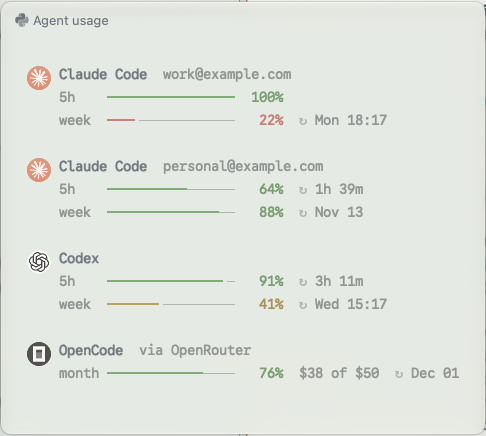

# agentmeter

See how much of your coding agents' usage limits is left, from the terminal or as a popup in [Rex](https://www.superlogical.com/rex). agentmeter finds the agents installed on your machine and lists each one: Claude Code and Codex with their **5-hour** and **weekly** limits, OpenCode with its provider's budget, and more.

- **Every agent you have installed**, found automatically, each with its own icon
- **Every Claude account**, side by side, each labelled with its email
- **A popup in Rex** on a shortcut you choose, centred and sized to fit. You can also dock it as a pane.
- **Your limits in Claude Code's status line**, showing the account that session uses



> If agentmeter saves you from hitting a limit mid-task, please **[⭐ star the repo](https://github.com/SaeedNoshadi89/agentmeter)**. It's the quickest way to help, and it brings us closer to `brew install agentmeter` without a tap. See [Contributing](#contributing).

Each bar shows the share left. Every agent and every window uses the same colors:

| Left | Color |
| --- | --- |
| 50% or more | green |
| under 50% | orange (your theme's yellow) |
| under 30% | red |

These are your terminal theme's own colors, and the popup uses your terminal font, so it matches your Rex theme.

Each agent is shown with its own round icon. The icons are downloaded once from each agent's website, through Google's favicon service, and cached in `~/.cache/agentmeter/icons`. They appear in terminals that can show images: Rex, kitty, Ghostty and WezTerm. Elsewhere, or with `--no-icons`, a text mark is used instead, such as `✻` for Claude Code and `>_` for Codex.

The Rex popup sizes itself to fit what it shows. Press **r** to refresh, or any other key to close it. `↻` marks when a limit resets.

## Install

**Homebrew**

Add the tap once, then install and upgrade like any other formula (`brew upgrade agentmeter`).

```sh
brew tap SaeedNoshadi89/tap
brew install agentmeter
agentmeter setup-rex        # optional: add the Rex popup (Shift+Cmd+U)
```

**Script**

```sh
curl -fsSL https://raw.githubusercontent.com/SaeedNoshadi89/agentmeter/main/install.sh | sh
```

The script puts `agentmeter` in `~/.local/bin` and, if Rex is installed, runs `agentmeter setup-rex` for you.

The only requirement is `python3`, with no extra packages.

| Variable (script only) | Effect |
| --- | --- |
| `AGENTMETER_BIN_DIR=/usr/local/bin` | Install somewhere else |
| `AGENTMETER_KEY=alt+cmd+u` | Use a different Rex shortcut |
| `AGENTMETER_NO_REX=1` | Skip the Rex setup |
| `AGENTMETER_UNINSTALL=1` | Remove the command and its Rex popup |

Set a variable on the `sh` side of the pipe, for example `curl -fsSL …/install.sh | AGENTMETER_KEY=alt+cmd+u sh`.

## Rex popup

`agentmeter setup-rex [--key shift+cmd+u]` adds a **Show Agent Usage** action to `~/.config/rex/init.lua` and reloads Rex. It sits between `-- >>> agentmeter >>>` markers, so running it again replaces the old block instead of adding a second one. If Rex rejects the new config, your file is left as it was. `agentmeter remove-rex` takes the block out.

### Floating or docked

The popup opens floating and closes when you press a key or click outside it.

| In the popup | Does |
| --- | --- |
| `d` | dock it as a pane beside the one you were in |
| `f` | float it again (when docked) |
| `r` | refresh now |
| `q` / `Esc` | close (when docked, other keys and clicks don't close it) |

A docked pane refreshes itself every minute. Rex's own **Float Pane** shortcut (Alt+Cmd+Enter) works too.

To make the shortcut always open it docked:

```sh
agentmeter style pane     # open as a docked pane
agentmeter style float    # back to the floating popup (default)
agentmeter style          # show the current style
```

### Changing the shortcut

The default shortcut is **Shift+Cmd+U**. To see or change it:

```sh
agentmeter shortcut              # show the current one
agentmeter shortcut alt+cmd+u    # change it
```

Rex reloads straight away, so the new key works at once. If Rex rejects the key, your config is left unchanged and you'll see an error.

You can also pick the key when you set up:

```sh
agentmeter setup-rex --key ctrl+shift+u
curl -fsSL https://raw.githubusercontent.com/SaeedNoshadi89/agentmeter/main/install.sh | AGENTMETER_KEY=ctrl+shift+u sh
```

Your choice is kept when you update or reinstall. Running setup again without `--key` doesn't reset it.

Keys use Rex's format: modifiers joined with `+`, such as `alt+cmd+u`, `ctrl+shift+u` or `cmd+;`. To check that a key isn't already used, run `rex keymap`.

## Claude Code status line

agentmeter can also show your limits in Claude Code's footer, under the prompt:

```
✻ 5h 49% ↻1h 11m · week 93%   >_ 5h 99% · week 49% ↻Thu 15:25   ▣ month 100%
```

The Claude part shows **the account that session is using**. With two accounts, each session shows its own numbers. Reset times appear only for windows under 50%.

```sh
agentmeter setup-claude     # turn it on for every Claude config folder
agentmeter remove-claude    # turn it off
```

Choose which agents appear with `--only`, using agent ids such as `claude`, `codex`, `opencode` and `gemini`:

```sh
agentmeter setup-claude --only claude          # just this session's Claude account
agentmeter setup-claude --only claude,codex    # Claude and Codex
```

Run it again to change your choice. Use `--force` to replace a status line you set up yourself.

Claude Code puts the status line on its own line under the prompt box. It can't share the row with Claude Code's mode indicator ("auto mode on …").

This sets `statusLine` in each `settings.json` and saves a backup as `settings.json.bak`. A folder that already has a different status line is left alone unless you add `--force`. The status line reads cached numbers only, so it takes about 80 ms. Numbers older than a minute are refreshed in the background.

## Usage

```sh
agentmeter                            # every agent and account
agentmeter --json                     # machine-readable output
agentmeter --claude-config ~/.claude-work   # one Claude account
agentmeter --no-icons                 # text marks instead of icons
agentmeter --demo                     # made-up accounts and numbers, for screenshots
agentmeter --popup                    # the popup view: r refreshes, any other key closes
agentmeter setup-rex | remove-rex     # add or remove the Rex popup
agentmeter shortcut [KEY]             # show or change the popup's shortcut
agentmeter style [float|pane]         # open the Rex view floating or docked
agentmeter statusline                 # one line for Claude Code's status line
agentmeter setup-claude | remove-claude   # turn that status line on or off
agentmeter --version
```

In Rex, press **Shift+Cmd+U** (or your own shortcut), search for "Show Agent Usage" in the command palette, or run `rex do agent_usage`.

## Supported agents

An agent is listed when its command is installed or its data folder exists.

| Agent | What's shown |
| --- | --- |
| ✻ Claude Code | 5-hour and weekly limits, for each account |
| >_ Codex | 5-hour and weekly limits, from its last run |
| ▣ OpenCode | One row for each provider it's signed in to. An OpenRouter key shows its budget, for example "Monthly $250 of $250". A Claude subscription login shows 5-hour and weekly limits. An API key is marked pay-as-you-go. |
| Gemini CLI, Cursor Agent, Amp, Copilot CLI, Qwen Code, Crush, Factory Droid, Aider | Listed when installed. Usage isn't available yet. |

To add an agent, add a row to `AGENTS` in `agentmeter`. Each row needs a check for whether the agent is installed, and a function that returns its meters.

## Several Claude accounts

If you use more than one Claude account, for example work and personal, agentmeter shows **each one separately**, labelled with its email:

```
✻ Claude Code  you@work.com
   5h    ━━━━━━━━━━━━━━━━  100%
   week  ━━────────────────   15%  ↻ Tue 09:30

✻ Claude Code  you@personal.com
   5h    ━━━━━━━━━━━──────   68%  ↻ 1h 27m
   week  ━━━━━━━━━━━━━━━╸   95%  ↻ Nov 14
```

Claude Code keeps each login in a config folder: `~/.claude` by default, or whatever `CLAUDE_CONFIG_DIR` points to. agentmeter finds every folder that has a login (`~/.claude`, `~/.claude-*` and `~/.config/claude*`) and reads the email from it. The terminal view and the Rex popup both show every account. To see just one, run `agentmeter --claude-config ~/.claude-work`.

## Where the numbers come from

| Agent | Source |
| --- | --- |
| Claude Code | `GET https://api.anthropic.com/api/oauth/usage`, using the token Claude Code saved when you logged in. On macOS that's the Keychain item `Claude Code-credentials`. For a custom config folder, the item name gets `-` plus the first 8 hex characters of the SHA-256 of the folder path. On Linux it's `<config folder>/.credentials.json`. |
| OpenCode | `~/.local/share/opencode/auth.json`. OpenRouter keys are checked with `GET https://openrouter.ai/api/v1/key`, and Claude logins with the same usage check as Claude Code. |
| Codex | The last `rate_limits` entry in `~/.codex/sessions/**/rollout-*.jsonl`. This is read locally, with no network call. The `primary` entry is the 5h window and `secondary` is the weekly one. |

Notes:
- **Codex** only updates these numbers when it runs, so they are as fresh as your last Codex turn. If a window's reset time has passed, it's shown as 100% left.
- **Claude's usage endpoint is undocumented** and may change.
- Results are cached for 60 seconds in `~/.cache/agentmeter.json`.

## Privacy

Each token or key is sent only to its own service: Claude tokens to `api.anthropic.com` and OpenRouter keys to `openrouter.ai`. agentmeter never logs or stores them, and never sends them anywhere else. Apart from the icon downloads, nothing else leaves your machine.

## Contributing

agentmeter is small and easy to extend, and help is welcome.

- **⭐ Star the repo.** Homebrew only accepts popular projects into its main repository, at roughly 75+ stars. Every star brings `brew install agentmeter` with no tap step closer.
- **Add an agent.** Each agent is a single row in `AGENTS` in [`agentmeter`](agentmeter): a check for whether it's installed, and a function that returns its meters. Many agents are listed but don't show usage yet, including Gemini CLI, Cursor Agent, Amp, Copilot CLI, Qwen Code, Crush, Factory Droid and Aider. If you know where one keeps its limits, a pull request would be great.
- **Report a problem.** [Open an issue](https://github.com/SaeedNoshadi89/agentmeter/issues) with your OS, terminal, agent and what you saw. `agentmeter --json` output helps, but remove your email first.
- **Share a screenshot.** `agentmeter --demo --popup` shows made-up accounts, so it's safe to post.

Pull requests should keep agentmeter dependency-free: one Python file using only the standard library.

## License

MIT
