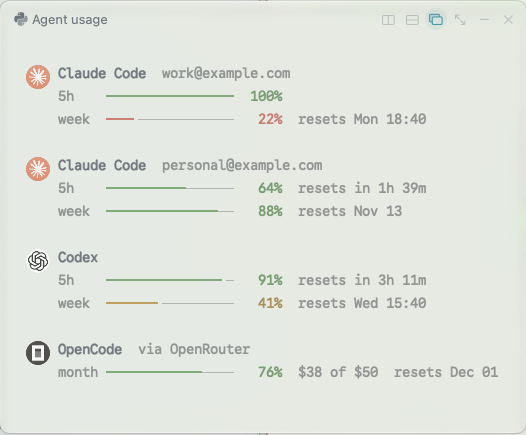
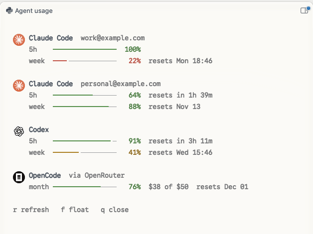
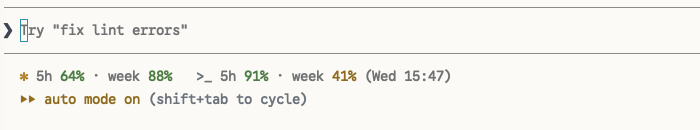
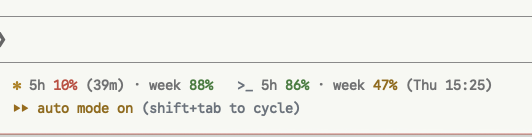
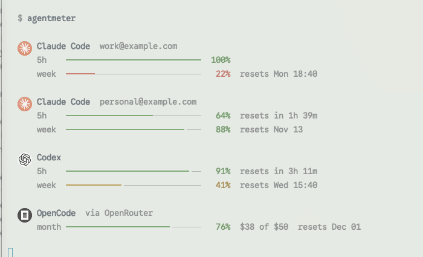

# agentmeter

See how much of your coding agents' usage limits is left: as a popup or pane in [Rex](https://www.superlogical.com/rex), in Claude Code's status line, or in any terminal.

agentmeter finds the agents installed on your machine and lists each one: Claude Code and Codex with their **5-hour** and **weekly** limits, OpenCode with its provider's budget, and more.



- **Every agent you have installed**, found automatically, each with its own icon
- **Every Claude account**, side by side, each labelled with its email
- **Four ways to see it:** a floating popup, a docked pane, Claude Code's status line, or plain terminal output
- **One Python file**, nothing else to install

```sh
brew install SaeedNoshadi89/tap/agentmeter
agentmeter setup
```

> ⭐ **If agentmeter helps you, please [star the repo](https://github.com/SaeedNoshadi89/agentmeter).** Stars help other people find it and bring `brew install agentmeter` without a tap closer.
> **Issues and pull requests are very welcome.** Found a bug, want another agent supported, or have an idea? [Open an issue](https://github.com/SaeedNoshadi89/agentmeter/issues) or send a PR. See [Contributing](#contributing).

## Contents

- [Four ways to see your usage](#four-ways-to-see-your-usage)
- [Installation guide](#installation-guide)
- [Configuration guide](#configuration-guide)
- [Reading the display](#reading-the-display)
- [Supported agents](#supported-agents)
- [Several Claude accounts](#several-claude-accounts)
- [Where the numbers come from](#where-the-numbers-come-from)
- [Privacy](#privacy)
- [Troubleshooting](#troubleshooting)
- [Contributing](#contributing)

## Four ways to see your usage

### 1. Floating popup (Rex)

Press **Shift+Cmd+U** in Rex. A small window opens in the middle of the screen, sized to fit. It shows the last known numbers straight away and refreshes them in the background, with "updating…" in its header meanwhile.


Close it by pressing any key or clicking anywhere outside it. Press `r` to refresh, or `d` to dock it as a pane.

### 2. Docked pane (Rex)

Press `d` in the popup, or set `agentmeter style pane` so the shortcut always opens it this way. It sits beside your work as a normal Rex pane, stays open when you click elsewhere, and refreshes itself every minute.



| Key | Does |
| --- | --- |
| `r` | refresh now |
| `f` | float it again |
| `q` or `Esc` | close it |

Rex's own **Float Pane** shortcut (Alt+Cmd+Enter) also switches between floating and docked.

### 3. Claude Code status line

A line under Claude Code's prompt box, showing **the account that session uses**, plus any other agents you choose.



When a limit runs low, it turns red and shows when it resets (here the 5-hour window is at 10% and resets in 39 minutes):



Turn it on with `agentmeter statusline on`, or answer yes during `agentmeter setup`. See [Status line](#status-line).

### 4. Terminal

Run `agentmeter` in any terminal. `agentmeter --json` prints the same data for scripts.



## Installation guide

### Requirements

- **macOS or Linux** with `python3`. macOS includes it once Xcode's Command Line Tools are installed, which Homebrew needs anyway.
- **At least one agent**, such as Claude Code, Codex or OpenCode, that you've signed in to.
- **Optional:** [Rex](https://www.superlogical.com/rex) for the popup and pane, and Claude Code for the status line.

### Step 1: install

**Homebrew** (recommended on macOS):

```sh
brew install SaeedNoshadi89/tap/agentmeter
```

This one line adds the tap and trusts it for you. Prefer the short name? Run `brew tap SaeedNoshadi89/tap` and `brew trust --formula saeednoshadi89/tap/agentmeter` once; after that, `brew install agentmeter` and `brew upgrade agentmeter` work.

**Install script** (macOS or Linux). This installs and then runs setup for you, so it's the whole job in one command:

```sh
curl -fsSL https://raw.githubusercontent.com/SaeedNoshadi89/agentmeter/main/install.sh | sh
```

**From source**

```sh
git clone https://github.com/SaeedNoshadi89/agentmeter.git
cd agentmeter
./install.sh
```

The install script takes these options:

| Variable | Effect |
| --- | --- |
| `AGENTMETER_BIN_DIR=/usr/local/bin` | Install somewhere other than `~/.local/bin` |
| `AGENTMETER_KEY=alt+cmd+u` | Use a different Rex shortcut |
| `AGENTMETER_NO_REX=1` | Don't set up the Rex popup |
| `AGENTMETER_NO_STATUSLINE=1` | Don't ask about the Claude Code status line |
| `AGENTMETER_UNINSTALL=1` | Remove the command and its Rex popup |

Put the variable on the `sh` side of the pipe, for example `curl -fsSL …/install.sh | AGENTMETER_KEY=alt+cmd+u sh`.

### Step 2: set up

```sh
agentmeter setup
```

Setup lists the agents it found and asks two questions, both defaulting to yes:

```
  agentmeter setup

  Agents found: Claude Code, Codex, OpenCode

  Add the Rex popup on shift+cmd+u? [Y/n]
  Show your limits in Claude Code's status line? [Y/n]

  Done. Try it:
    In Rex, press shift+cmd+u
    In Claude Code, start a new session to see the status line
    In any terminal, run: agentmeter
```

- **Skip the questions** and accept both: `agentmeter setup --yes`.
- **Skip a question:** add `--no-rex` or `--no-statusline`.
- **Without Rex or Claude Code**, setup skips that question and says so.
- **Run it again** any time; it never duplicates anything and keeps your earlier choices.

That's it. Press the shortcut in Rex, or run `agentmeter` in any terminal.

### Updating

```sh
brew upgrade agentmeter                 # Homebrew
curl -fsSL https://raw.githubusercontent.com/SaeedNoshadi89/agentmeter/main/install.sh | sh   # script
```

Updating keeps your shortcut, style and status line choices.

### Uninstalling

```sh
agentmeter statusline off               # remove the Claude Code status line
agentmeter remove-rex                   # remove the Rex popup
brew uninstall agentmeter && brew untap SaeedNoshadi89/tap   # Homebrew
AGENTMETER_UNINSTALL=1 sh -c "$(curl -fsSL https://raw.githubusercontent.com/SaeedNoshadi89/agentmeter/main/install.sh)"   # script
rm -rf ~/.cache/agentmeter ~/.cache/agentmeter.json ~/.config/agentmeter   # cached data and preferences
```

If you installed both ways, the copy in `~/.local/bin` usually comes first on your `PATH`. Remove it with the script uninstall above so `brew upgrade` takes effect.

## Configuration guide

Everything is set with `agentmeter` commands. There's no config file to edit by hand.

### All settings at a glance

| Setting | Command | Default |
| --- | --- | --- |
| Rex shortcut | `agentmeter shortcut KEY` | `shift+cmd+u` |
| Rex view style | `agentmeter style float` or `pane` | `float` |
| Rex popup on/off | `agentmeter setup-rex` / `remove-rex` | on after the script install |
| Status line on/off | `agentmeter statusline on` / `off` / `toggle` | off |
| Status line agents | `agentmeter statusline on --only claude,codex` | all agents |
| Icons | `--no-icons` on any command | icons on in Rex, kitty, Ghostty and WezTerm |
| One Claude account | `agentmeter --claude-config ~/.claude-work` | every account |

To see the current values:

```sh
agentmeter shortcut            # current shortcut
agentmeter style               # float or pane
agentmeter statusline status   # on or off, and which agents
```

### Shortcut

```sh
agentmeter shortcut alt+cmd+u
```

Rex reloads straight away, so the new key works at once. If Rex rejects the key, your config is left unchanged and you'll see an error. Keys use Rex's format: modifiers joined with `+`, such as `alt+cmd+u`, `ctrl+shift+u` or `cmd+;`. Run `rex keymap` to check that a key isn't already used.

You can also choose the key during setup: `agentmeter setup-rex --key ctrl+shift+u`.

### Floating or docked

```sh
agentmeter style pane     # the shortcut opens a docked pane
agentmeter style float    # the shortcut opens the floating popup
```

You can switch any time with `d` and `f` inside the view.

### Status line

```sh
agentmeter statusline on                        # every agent
agentmeter statusline on --only claude          # just this session's Claude account
agentmeter statusline on --only claude,codex    # Claude and Codex
agentmeter statusline off
agentmeter statusline toggle
agentmeter statusline status
```

In Rex, you can also search the command palette (Cmd+P) for **Toggle Agent Usage in Claude Code Status Line**.

- **Agent ids** for `--only` are `claude`, `codex`, `opencode`, `gemini`, `cursor`, `amp`, `copilot`, `qwen`, `crush`, `droid` and `aider`.
- **The Claude part** always shows the account of that session, so with two accounts each session shows its own numbers.
- **Your `--only` choice is remembered**, so turning it off and on keeps it.
- **Where it's set:** `statusLine` in the `settings.json` of each Claude Code config folder. The old file is saved as `settings.json.bak`.
- **An existing status line** of your own is left alone. Add `--force` to replace it.
- **When changes appear:** in new Claude Code sessions.
- Claude Code shows the status line on its own line under the prompt box. It can't share the row with the mode indicator ("auto mode on …").

### Files agentmeter writes

| File | What it holds |
| --- | --- |
| `~/.config/rex/init.lua` | The Rex action and shortcut, between `-- >>> agentmeter >>>` markers. `setup-rex`, `shortcut` and `style` rewrite only this block. |
| `<Claude config folder>/settings.json` | The `statusLine` entry, when the status line is on |
| `~/.config/agentmeter/prefs.json` | Your status line agent choice |
| `~/.cache/agentmeter.json` | The last numbers, reused for 60 seconds |
| `~/.cache/agentmeter/icons/` | The downloaded agent icons |

### Resetting everything to defaults

```sh
agentmeter statusline off
rm -rf ~/.config/agentmeter ~/.cache/agentmeter ~/.cache/agentmeter.json
agentmeter remove-rex && agentmeter setup-rex
```

## Reading the display

| Part | Meaning |
| --- | --- |
| `5h`, `week`, `month` | The limit's window: Claude and Codex have 5-hour and weekly limits, and an OpenRouter key has its budget period |
| bar and `%` | The share **left** in that window |
| `resets in 1h 39m`, `resets Mon 18:40` | When the window starts over |
| `$38 of $50` | Budget left, for keys with a spending limit |
| `as of 12:31` | When Codex last updated its numbers (see [Where the numbers come from](#where-the-numbers-come-from)) |
| `updating…` in the header | Fresh numbers are on the way |

| Left | Color |
| --- | --- |
| 50% or more | green |
| under 50% | orange (your theme's yellow) |
| under 30% | red |

These are your terminal theme's own colors, and every view uses your terminal font, so agentmeter matches your Rex theme.

Each agent is shown with its own round icon. The icons are downloaded once from each agent's website, through Google's favicon service, and cached locally. They appear in terminals that can show images: Rex, kitty, Ghostty and WezTerm. Elsewhere, or with `--no-icons`, a text mark is used instead, such as `✻` for Claude Code and `>_` for Codex.

## Supported agents

An agent is listed when its command is installed or its data folder exists.

| Agent | What's shown |
| --- | --- |
| Claude Code | 5-hour and weekly limits, for each account |
| Codex | 5-hour and weekly limits, from its last run |
| OpenCode | One row for each provider it's signed in to. An OpenRouter key shows its budget, for example "Monthly $38 of $50". A Claude subscription login shows 5-hour and weekly limits. An API key is marked pay-as-you-go. |
| Gemini CLI, Cursor Agent, Amp, Copilot CLI, Qwen Code, Crush, Factory Droid, Aider | Listed when installed. Usage isn't available yet; [help add it](#contributing). |

## Several Claude accounts

If you use more than one Claude account, for example work and personal, agentmeter shows **each one separately**, labelled with its email, as in the screenshots above.

Claude Code keeps each login in a config folder: `~/.claude` by default, or whatever `CLAUDE_CONFIG_DIR` points to. agentmeter finds every folder that has a login (`~/.claude`, `~/.claude-*` and `~/.config/claude*`) and reads the email from it.

- **Popup, pane and terminal** show every account.
- **The status line** shows the account of its own session.
- **For just one account**, run `agentmeter --claude-config ~/.claude-work`.

## Where the numbers come from

| Agent | Source |
| --- | --- |
| Claude Code | `GET https://api.anthropic.com/api/oauth/usage`, using the token Claude Code saved when you logged in. On macOS that's the Keychain item `Claude Code-credentials`. For a custom config folder, the item name gets `-` plus the first 8 hex characters of the SHA-256 of the folder path. On Linux it's `<config folder>/.credentials.json`. |
| OpenCode | `~/.local/share/opencode/auth.json`. OpenRouter keys are checked with `GET https://openrouter.ai/api/v1/key`, and Claude logins with the same usage check as Claude Code. |
| Codex | The last `rate_limits` entry in `~/.codex/sessions/**/rollout-*.jsonl`. This is read locally, with no network call. |

**How fresh the numbers are:**
- Numbers are reused for 60 seconds, then fetched again. All agents are fetched at the same time.
- The popup shows the last numbers at once and updates in place. The docked pane refreshes every minute. The status line refreshes in the background when its numbers are over a minute old.
- **Codex** only updates its numbers when it runs, so they are as fresh as your last Codex turn. If a window's reset time has passed, it's shown as 100% left.
- **Claude's usage check is undocumented** and may change.
- **If a check fails**, for example "rate limited" when the service is asked too often, agentmeter keeps showing the last good numbers, marked "as of" with the time and reason. After a rate limit it waits 5 minutes, or as long as the service asks, before trying that account again.

## Privacy

Each token or key is sent only to its own service: Claude tokens to `api.anthropic.com` and OpenRouter keys to `openrouter.ai`. agentmeter never logs or stores them, and never sends them anywhere else. Apart from those checks and the one-time icon downloads, nothing leaves your machine.

To share a screenshot safely, use `--demo`, which shows made-up accounts and numbers. All the images in this README were made that way.

## Troubleshooting

| Problem | Fix |
| --- | --- |
| An agent is missing | Check that its command runs in your terminal and that you've signed in to it at least once. |
| Claude shows "not logged in" or "login expired" | Run `claude` and sign in again. |
| "rate limited, retrying soon" | The usage check was called too often. agentmeter waits and retries on its own, and keeps the last good numbers meanwhile. |
| Codex numbers look old | Codex only updates them when it runs. Use Codex and they refresh. |
| The shortcut does nothing | Run `rex config check`. If agentmeter isn't listed, run `agentmeter setup-rex`. |
| No icons, only text marks | Your terminal can't show images, or the icons couldn't be downloaded. The text marks work the same. |
| The status line doesn't appear | Start a new Claude Code session. Check `agentmeter statusline status`. |
| `brew upgrade` changes nothing | Another copy in `~/.local/bin` comes first on your `PATH`. See [Uninstalling](#uninstalling). |
| `Refusing to load formula … from untrusted tap` | Run `brew trust --formula saeednoshadi89/tap/agentmeter`, then `brew install agentmeter` again. |

Still stuck? **[Open an issue](https://github.com/SaeedNoshadi89/agentmeter/issues).** That's how agentmeter gets better.

## Contributing

**Feel free to open issues and contribute. All help is welcome, big or small.**

- **⭐ Star the repo.** It helps other people find agentmeter. Homebrew only accepts popular projects into its main repository, at roughly 75+ stars, so every star brings plain `brew install agentmeter` closer.
- **Open an issue.** Report a bug, ask a question, or suggest an idea in [Issues](https://github.com/SaeedNoshadi89/agentmeter/issues). Include your OS, terminal and agent. `agentmeter --json` output helps, but remove your email first.
- **Add an agent.** Each agent is one row in `AGENTS` in [`agentmeter`](agentmeter): a check for whether it's installed, and a function that returns its meters. Gemini CLI, Cursor Agent, Amp, Copilot CLI, Qwen Code, Crush, Factory Droid and Aider are listed but don't show usage yet. If you know where one keeps its limits, a pull request would be great.
- **Improve the docs or design.** Clearer wording, better screenshots and ideas for the popup are all welcome.
- **Share it.** `agentmeter --demo --popup` shows made-up data, so it's safe to post.

To work on it:

```sh
git clone https://github.com/SaeedNoshadi89/agentmeter.git
cd agentmeter
./agentmeter --demo          # try changes with made-up data
tests/cli.sh ./agentmeter    # run the CLI tests (your real config is never changed)
./install.sh                 # install your local copy
```

Please keep agentmeter dependency-free: one Python file using only the standard library.

Maintainers release with `scripts/release.sh VERSION "summary"` after setting `VERSION` in `agentmeter`. It tags the release, publishes it on GitHub, updates the Homebrew formula and checks that it installs.

## License

MIT
